<p align="center">
  
</p>

<h1 align="center">Gajae</h1>

<p align="center">
  A desktop home for coding-agent sessions: Claude Code, omp, Codex and <a href="https://github.com/Yeachan-Heo/gajae-code">GJC</a>.<br>
  <sub>macOS · Apple silicon</sub>
</p>

<p align="center">
  
</p>

Gajae is an Electron app for running coding agents without living in a terminal.
Pick the agent per session: Claude Code, omp (Oh My Pi), Codex, GJC, or a plain
shell. Gajae never embeds an agent. Claude Code, omp and Codex run as their own
CLI in a terminal that herdr-core keeps alive across app restarts. For Claude
Code and omp, Gajae also offers a chat view built from the agent's own session
file and answers their tool approvals from a card. GJC sessions go through GJC's public
`gjc sdk session` CLI and the session files GJC already writes, so a request
started in the app can be checked from the terminal and the other way round.

The richest features (questions, goals, side chat, model picker, parallel runs,
search) are GJC's. Other agents get their terminal, status where the agent
reports it, and remote access; Claude Code and omp also the chat view and tool
approvals.

## Demo

<p align="center">
  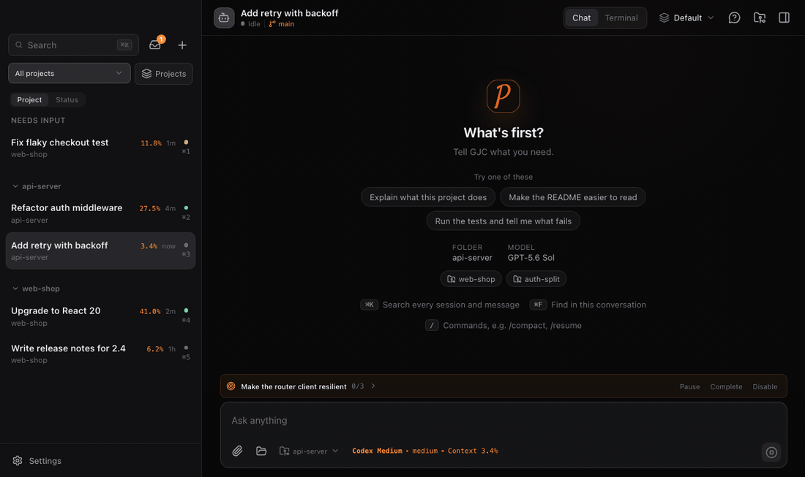
</p>

The app running on its built-in sample data. A request reads code and runs the
tests, stops to ask which retry policy to use, then edits and finishes while the
goal above the composer ticks to 3/3. Full quality:
[demo.mp4](docs/media/demo.mp4), [promo.mp4](docs/media/gajae-promo.mp4).

## Feature tour

Each clip is the real app on its built-in sample data.

<table>
  <tr>
    <td width="50%" valign="top">
      <strong>Approve once, skip the rest</strong><br>
      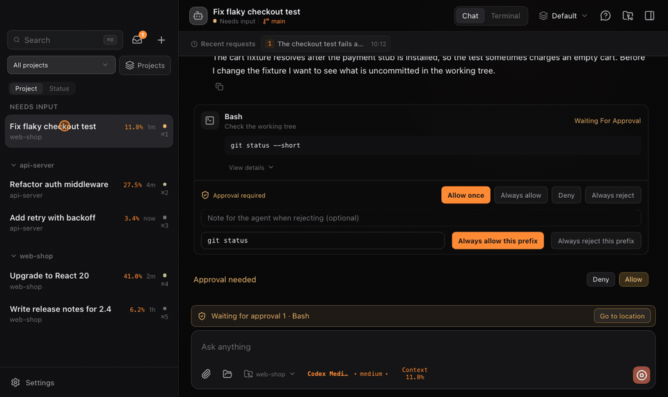
      <sub>Edit the command prefix on an approval card and always allow it. The
      next matching command runs without asking.</sub>
    </td>
    <td width="50%" valign="top">
      <strong>Side chat</strong><br>
      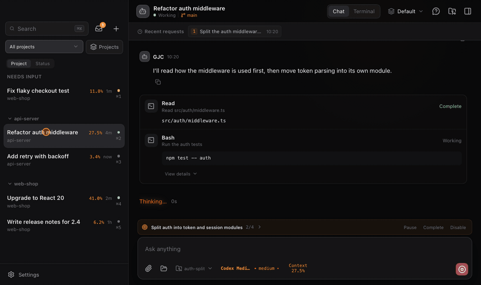
      <sub>Press ⌘⇧B to ask about the session while it keeps working. The answer
      stays out of the transcript.</sub>
    </td>
  </tr>
  <tr>
    <td width="50%" valign="top">
      <strong>Diagrams in chat</strong><br>
      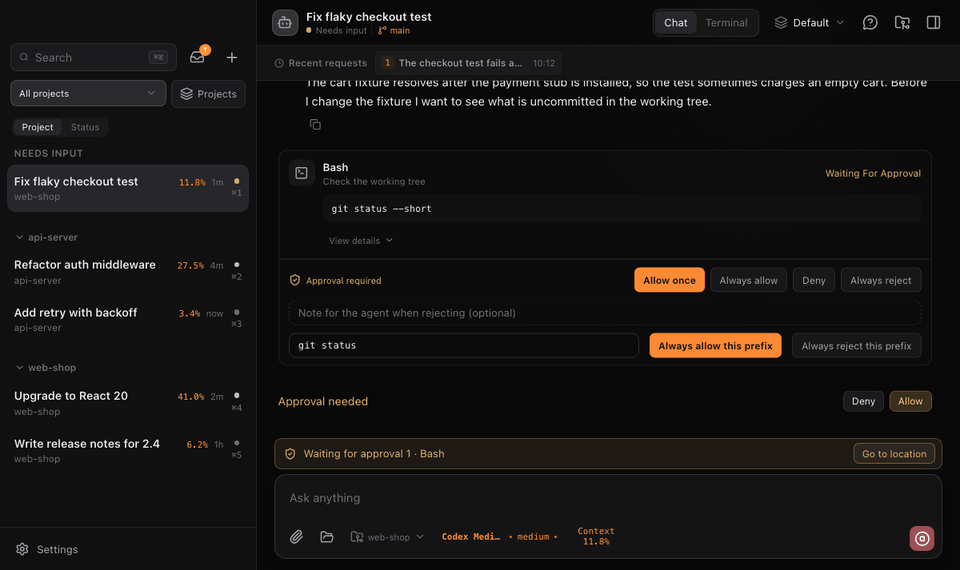
      <sub>Mermaid blocks in a reply render as diagrams.</sub>
    </td>
    <td width="50%" valign="top">
      <strong>Next-input suggestion</strong><br>
      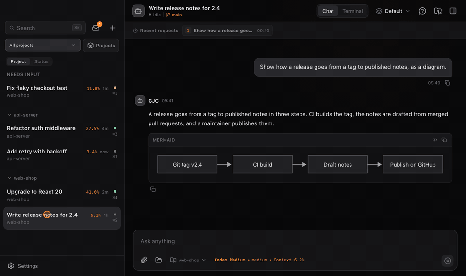
      <sub>When a turn ends, a suggested next message appears in the empty
      composer. Tab accepts it.</sub>
    </td>
  </tr>
  <tr>
    <td width="50%" valign="top">
      <strong>Queue while it runs</strong><br>
      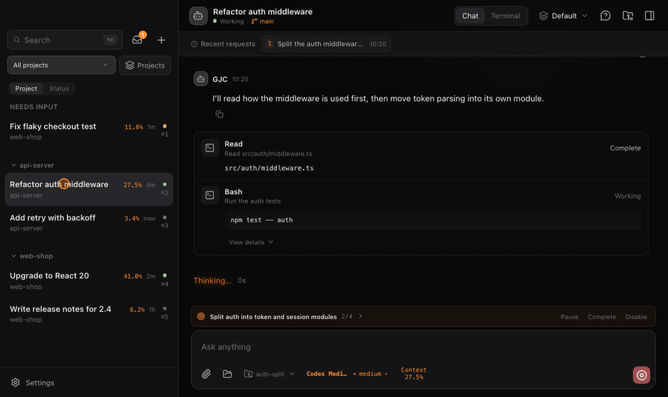
      <sub>Queue follow-ups during a turn, reorder them with the arrows, or
      discard one.</sub>
    </td>
    <td width="50%" valign="top">
      <strong>Model picker</strong><br>
      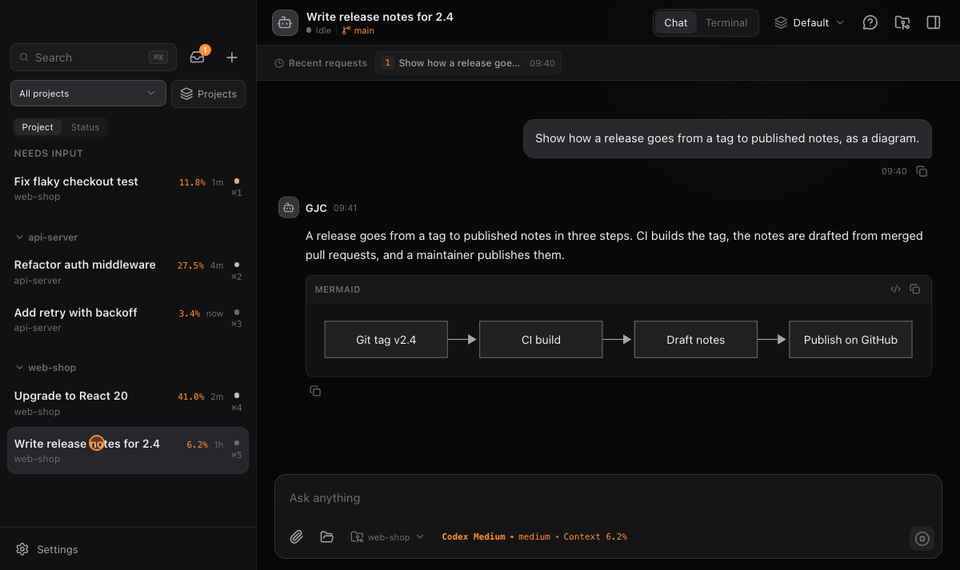
      <sub>Switch tabs, search, and star favorites.</sub>
    </td>
  </tr>
  <tr>
    <td width="50%" valign="top">
      <strong>Review the changes</strong><br>
      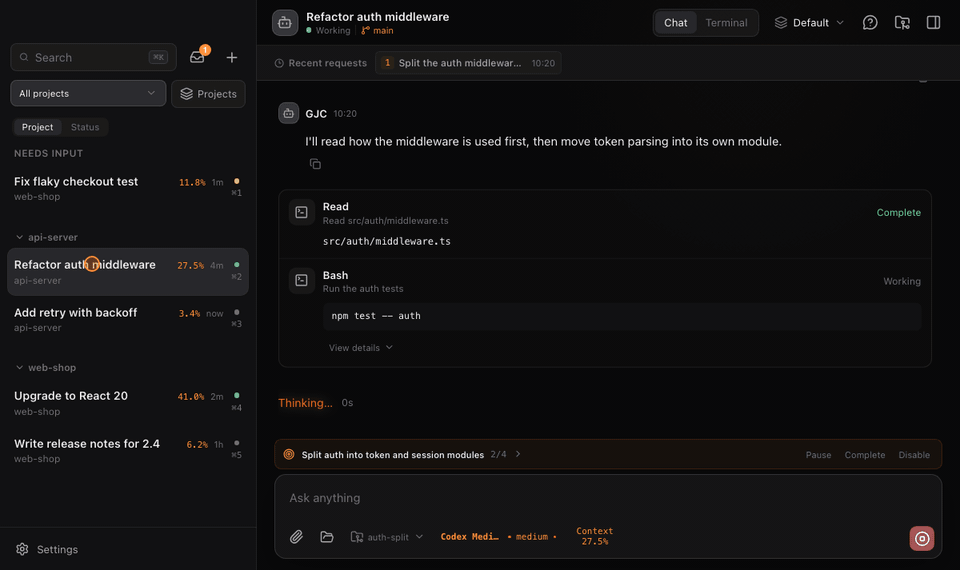
      <sub>Select diff lines, comment, and send the comments back to the agent
      as one review.</sub>
    </td>
    <td width="50%" valign="top">
      <strong>Projects rail</strong><br>
      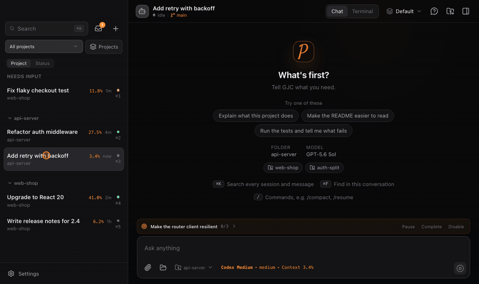
      <sub>Sessions group by project. One click switches to the by-status
      view.</sub>
    </td>
  </tr>
</table>

## Features

- **Live conversations.** Replies stream in with reasoning and every read,
  command and edit as its own card. Mermaid blocks render as diagrams. While a
  turn runs, Enter queues the next message or steers it into the turn (your
  choice in Settings). Queued messages can be reordered or removed, and Esc
  stops the turn.
- **Questions and plan approvals.** When GJC asks (a deep interview, a ralplan
  approval), the choices appear as a card above the composer. Press 1–9 or type
  your own answer.
- **Tool approvals.** With `매번 확인`, a command waits on its card until you
  allow or reject it, from the window or a paired phone. A rejection can tell the
  agent what to do instead. Needs GJC 0.19.3 or later.
- **Project command rules.** Save a command prefix from an approval card as
  always allow or always reject for that project. Matching commands are decided
  without a card, in every session of the project. An allow rule never covers a
  command that chains, pipes or redirects; that one still asks. Review and
  delete rules in Settings.
- **Side chat.** `/btw` or ⌘⇧B asks about the session in a side panel while it
  keeps working. Nothing is added to the transcript.
- **Next-input suggestion.** When a turn ends, the composer offers a likely next
  message. Tab takes it, Esc dismisses it. It follows GJC's `promptSuggestions`
  setting.
- **Changed files and review.** See the session's diff, comment on lines, and
  send the comments back as a review. A folder holding several repositories
  shows each one's changes.
- **Goals.** An active goal stays pinned above the composer with its progress.
  Open it to see each task.
- **Model picker.** Tabs, search and favorites for GJC's models, with the Fast
  tier toggle in the same menu.
- **Projects sidebar.** Sessions group by repository, worktrees included.
  Anything waiting on you sits at the top. Switch to a by-status view any time.
- **Any coding agent.** New sessions open the agent you chose last (on first
  launch, the first installed of Claude Code, omp, Codex and GJC), on its
  terminal or chat view, with a permission mode per session. Terminals keep
  running while you look elsewhere and after the app quits. Settings > Agents
  shows what was found on this Mac and each agent's defaults.
- **Repository screen.** Branches, worktrees, issues, pull requests and CI for
  the project, through the `gh` CLI.
- **Remote access.** Pair a phone over Tailscale and follow or drive the same
  sessions from it.
- **Desktop integration.** Menu bar status, a Dock badge, notifications per event,
  a ⌃⌥Space quick input from any app, and keep-awake while a run is going.
- **First-run setup.** Choose the agent to start with from the ones found on
  this Mac. Choosing GJC on a Mac without it installs it and signs you in to a
  provider. No terminal needed.

<table>
  <tr>
    <td>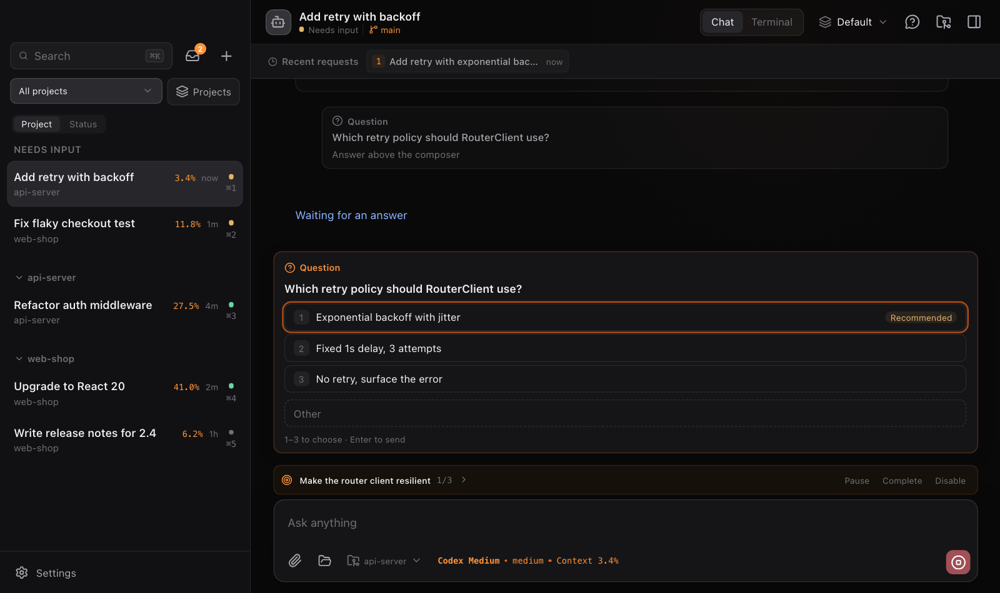</td>
    <td>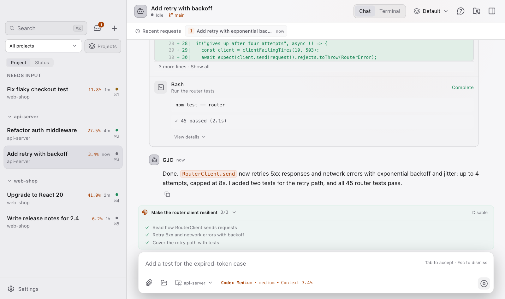</td>
  </tr>
</table>

## Install

Gajae needs an Apple-silicon Mac. The [`gh` CLI](https://cli.github.com), signed
in with `gh auth login`, is optional and powers the repository screen.

Run the installer in Terminal:

```bash
curl -fsSL https://raw.githubusercontent.com/Heyaaz/gajae-bot/main/install.sh | sh
```

The installer downloads the latest release, checks its SHA-256, puts
`Gajae.app` in `/Applications` (or `~/Applications` if that is not writable)
and opens it. Run it again to update.

The app is not notarized yet. macOS blocks a copy downloaded in a browser, so
use the installer rather than the ZIP on the releases page.

On first launch, Gajae lists the agents it found (Claude Code, omp, Codex, GJC
and a shell) and asks which one new sessions open. An agent that is already
installed is ready at once: the first session dialog opens on it. GJC is not
required. Choosing GJC on a Mac without it walks you through setup:

1. Gajae installs the GJC CLI from the public
   [`Yeachan-Heo/gajae-code`](https://github.com/Yeachan-Heo/gajae-code)
   releases, checked against their SHA-256, into `~/.local/bin/gjc`. That is
   where GJC's own installer puts it, so `gjc update` keeps working.
2. You sign in to one provider through GJC's own login. GJC stores the
   credential; Gajae does not.
3. Gajae applies GJC's recommended model profile and opens the first
   conversation.

A Mac that already runs GJC skips the install. GJC `0.18.12` or newer is
required for GJC sessions. A settings file from before agents could be chosen
keeps opening GJC.

## Quick start

1. Press **⌘T** (or **+**), pick the agent and a folder. The dialog starts on
   the agent you chose last.
2. Type a request and press **Enter**. Drop files in to send them as local
   paths; images go to the model as images.
3. While it runs, keep typing to queue the next request (or steer it in, if
   you set Enter to steer), or press **Esc** to stop.
4. Answer question cards with **1–9**, then **Enter**.
5. Ask a side question with **⌘⇧B** without stopping the run.

| Key | Action |
| --- | --- |
| `⌘T` | New session |
| `⌘1`–`⌘9` | Select a session in sidebar order |
| `⌘K` | Search sessions and messages |
| `⌥⌘U` | Inbox |
| `⌃⌥Space` | Quick input from any app |
| `⌘⇧B` | Side chat |
| `Tab` | Accept the suggested next message |
| `Shift+Tab` | Cycle effort |
| `Esc` | Stop the current run |

## Documentation

- [Using Gajae](docs/usage.md): the full guide, from running turns and slash
  commands to deleting sessions and parallel runs.
- [Remote access](docs/remote-access.md): pairing a phone or a second machine.
- [Developing Gajae](docs/development.md): running from source, packaging,
  and GJC compatibility notes.
- [Feature map](docs/features/README.md): scripted checks for each feature.

## Build from source

Node.js 24 or newer:

```bash
npm install
npm test
npm run dev:desktop    # Electron + Vite
npm run package:mac    # local, ad-hoc signed app in release/
```

See [Developing Gajae](docs/development.md) for public release signing and
the project layout.

## License

Gajae source code is available under the [MIT License](LICENSE). A public binary
release is produced only after the maintainer separately confirms redistribution
rights for the bundled artwork.
